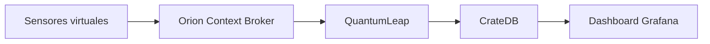

# Proyecto 3 · Smart City con FIWARE

> Proyecto del módulo **Big Data aplicado** (IABD). Ciudad inteligente simulada con sensores virtuales (temperatura/humedad, CO₂, calidad del agua) integrados mediante FIWARE, con QuantumLeap y CrateDB. Arquitectura streaming.

## Descripción y objetivo

Simular sensores de una smart city, publicar sus medidas en el Context Broker de FIWARE y almacenar el histórico para su análisis.

## Arquitectura



*Diagrama provisional (Bloque 0). Se actualizará al terminar cada bloque.*

## Fuentes de datos

| Fuente | URL / origen | Formato | Frecuencia de actualización | Licencia | Última ingesta |
|---|---|---|---|---|---|
| Sensores virtuales | Simulador propio | JSON (NGSI) | Continua | — | — |

## Estructura del repositorio

| Carpeta | Contenido |
|---|---|
| `ingesta/` | Simuladores de sensores |
| `etl/` | Transformaciones |
| `dashboard/` | Paneles de Grafana |
| `docs/` | Capturas y diagramas |

## Cómo desplegar el entorno

```bash
docker compose up -d
docker compose ps
```

## Bitácora de prácticas

### Bloque 0 · Entorno

- Objetivo: dejar preparado el repositorio.
- Pasos realizados: creación del repo con la estructura de la práctica, `.gitignore` del módulo, primer commit y publicación en GitHub.
- Problemas encontrados y solución: —
- Resultado: repositorio publicado.

### Bloque 1 · Ingesta batch

- Objetivo: —
- Pasos realizados: —
- Problemas encontrados y solución: —
- Resultado: —

## Decisiones técnicas

| Decisión | Alternativa descartada | Motivo |
|---|---|---|
| FIWARE (Orion + QuantumLeap) | Broker MQTT propio | Estándar de smart city y modelo NGSI del módulo |

## Incidencias resueltas

*Ninguna por ahora.*
